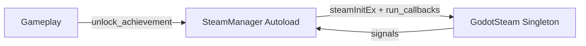

# Godot 4 Steamworks (GodotSteam) Agent Skill

> **Clasificación**: Skill Especializada (Godot 4 / GodotSteam) — Instalable en `.skill/godot-steamworks-agent-skill/`.

## 📌 Propósito y Alcance

Estandariza la integración de Steamworks en Godot 4 mediante GodotSteam: inicialización con `steamInitEx()`, ejecución de `Steam.run_callbacks()` en `_process()`, logros/estadísticas con `storeStats()`, Steam Cloud, Lobbies y exclusión de `steam_appid.txt` en builds de release.

## ⚡ $-Comandos

| Comando | Acción | Descripción |
|---|---|---|
| `$steam` | Bootstrap | Activa reglas y patrones de GodotSteam. |
| `$steam:audit` | Auditoría | Verifica `steamInitEx()`, `run_callbacks()`, `storeStats()`, fallback sin Steam y exclusión de `steam_appid.txt`. |
| `$steam:lobbies` | Multiplayer | Guía Lobbies, P2P y SteamNetworkingSockets. |

## 🧩 Arquitectura / Diagrama de Flujo



## ⚡ Quick Start

```bash
git submodule add git@github.com:Agent-Rules-Ecosystem/godot-steamworks-agent-skill.git .skill/godot-steamworks-agent-skill
```

Invoca `$steam` para activar la habilidad o `$steam:audit` para generar el reporte en `overview/work/skill/godot-steamworks.md`.
