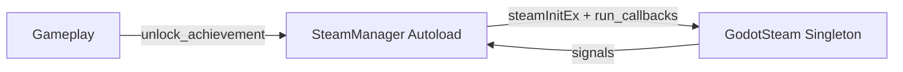

# Godot 4 Steamworks (GodotSteam) Agent Skill

## Matriz de Capacidades



## Protocolo de Auditoría (`$steam:audit`)

1. Verificar inicialización con `steamInitEx()` y manejo de fallo sin crash cuando Steam no está activo.
2. Confirmar presencia de `Steam.run_callbacks()` en `_process()` y `storeStats()` tras `setAchievement()`.
3. Comprobar que `steam_appid.txt` esté en `.gitignore` y excluido del preset de exportación release.
4. Persistir hallazgos en `overview/work/skill/godot-steamworks.md`.

## Patrón Técnico Canónico

```gdscript
class_name SteamManager
extends Node

const APP_ID: int = 480 # Reemplazar por AppID real
var is_steam_ready: bool = false

func _ready() -> void:
	if not Engine.has_singleton("Steam"):
		return
	var init: Dictionary = Steam.steamInitEx(APP_ID, true)
	is_steam_ready = init.get("status", -1) == 0

func _process(_delta: float) -> void:
	if is_steam_ready:
		Steam.run_callbacks()
```

## 📝 Persistencia y Salida Activa

Guardar resultados de auditoría en `overview/work/skill/godot-steamworks.md` con el esquema estándar:

| ID | Tipo | Estado | Resumen | Evidencia/Ruta | Acción Requerida |
|---|---|---|---|---|---|
| `s1` | `auditoria` | `activo` | Hallazgo concreto | `ruta/archivo#L10` | Corrección sugerida |
